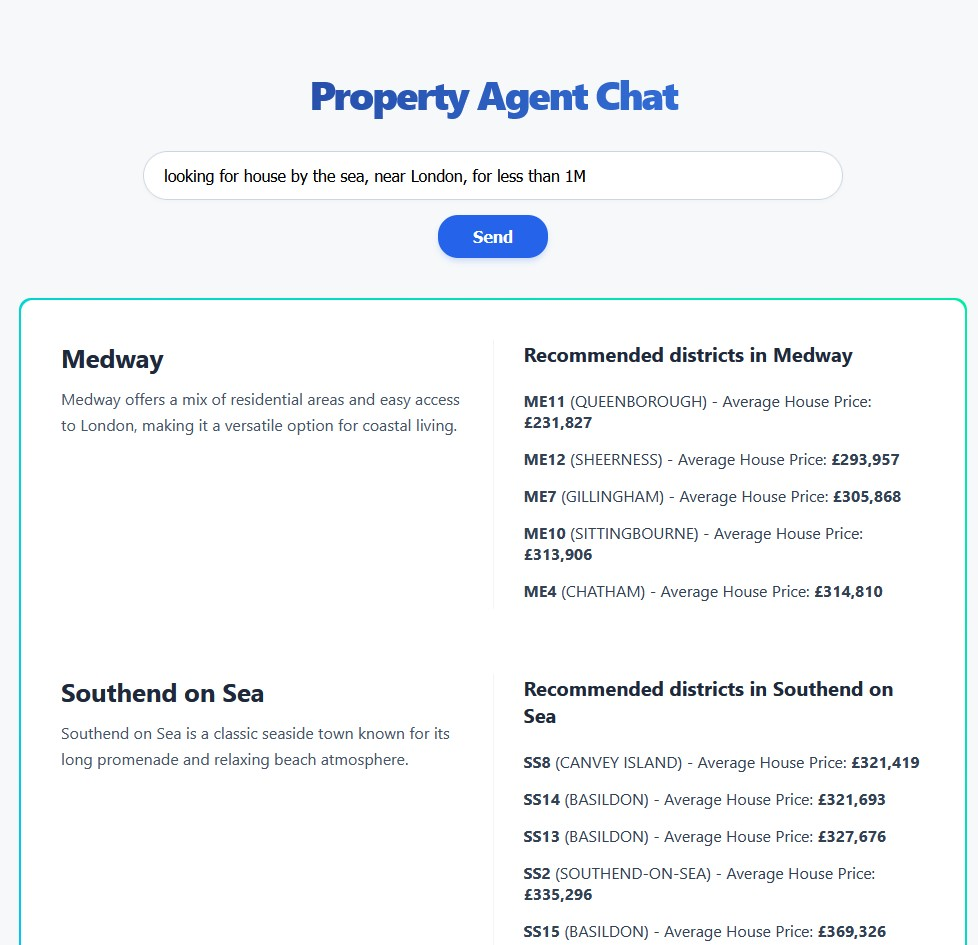

# Introduction:
Property Agent Chat is an AI application that provides suggestion where to buy property in England or Wales (postcode areas and districts) based on user query.
This application is an example how to use AWS Strands library in FastAPI project on localhost.
Instead of using AWS Bedrock infrastructure, this application uses Ollama and Postgres on localhost.

# Prerequisites:
- Ollama
- model mxbai-embed-large:335m
- model gemma4:e4b
- RAM: 10GB to load this model
- Postgres DB (and DB instance for this app)
- Postgres vector enabled
- uv (package and project manager)

# Steps:
- Install Ollama: https://ollama.com/
- Pull models:
  - ollama pull mxbai-embed-large:335m
  - ollama pull gemma4:e4b
- Configure DATABASE_URL in .env file
- Run:
  - uv sync
  - uv run uvicorn app.main:app
- Open localhost:8000 in browser

# Notes:
To prepare data for postcode areas, we used following prompt in Gemini:
"Generate a description for postcode areas: [list 5 by 5 to avoid consecutive description]
Use only simple English and short sentences.
Description should include data that property buyers are looking for,
like region, nearest major city, Landscape Type, Settlement Density, Transit Connectivity, Architectural Style, Climate Profile, Social Demographic, Cultural mix, Lifestyle Pace, Economic Profile, Environmental Quality, and Proximity to Nature.
Write a single, cohesive paragraph. Use a variety of synonyms.
This will be used to generate embedding with 512-token limit.
Keep your paragraph High-Density."

If you want to regenerate embeddings for areas, you can set them to null in database.
On next start, application will run code to generate embeddings using mxbai-embed-large model.
This might take several minutes.

If you want to recalculate prices per district, using latest Land Registry data,  there is a Spring Batch application [property-data-ingestion-service](https://github.com/sarcevic/property-data-ingestion-service).
